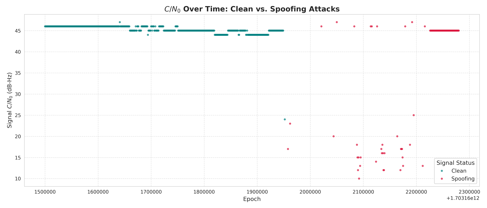
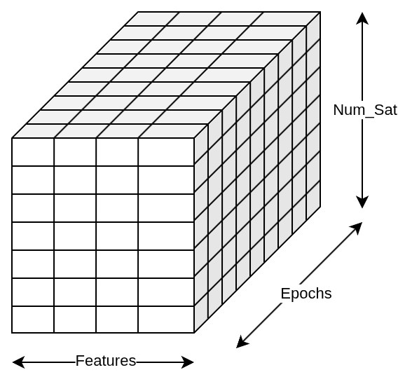
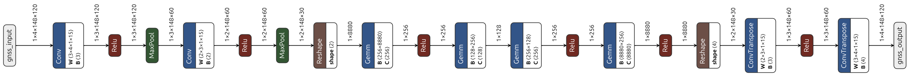
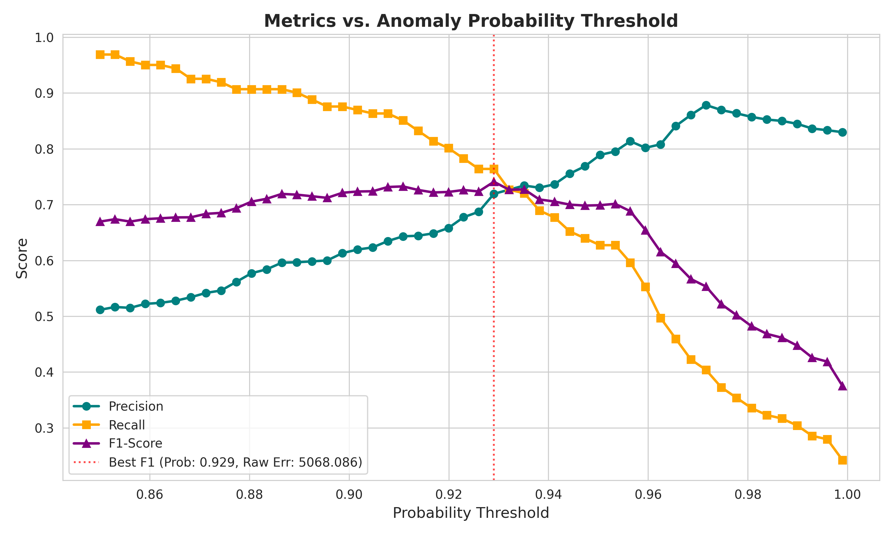
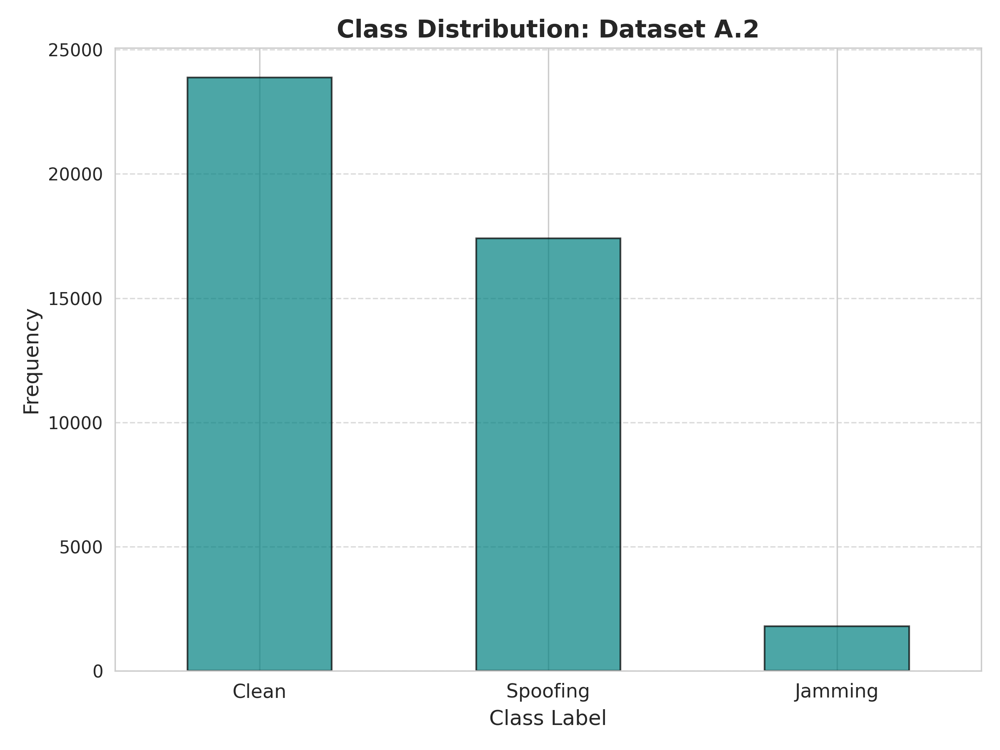
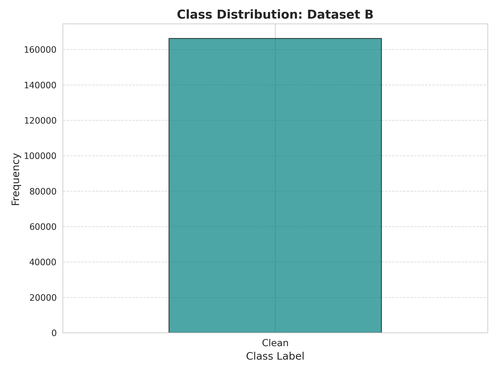
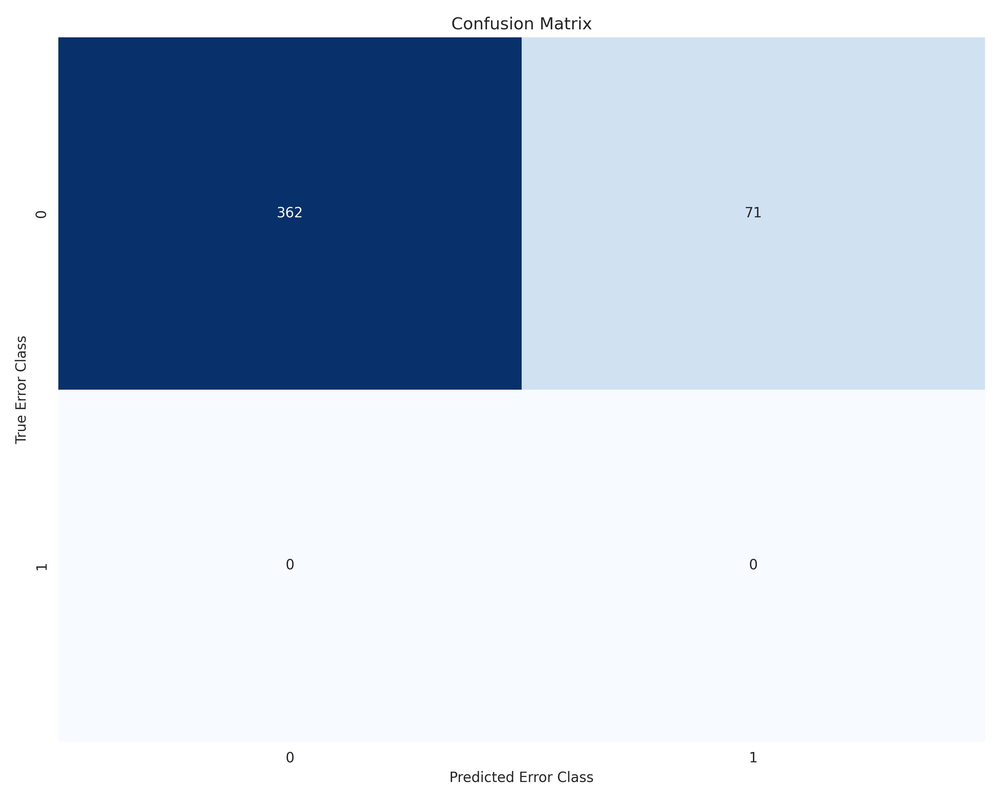
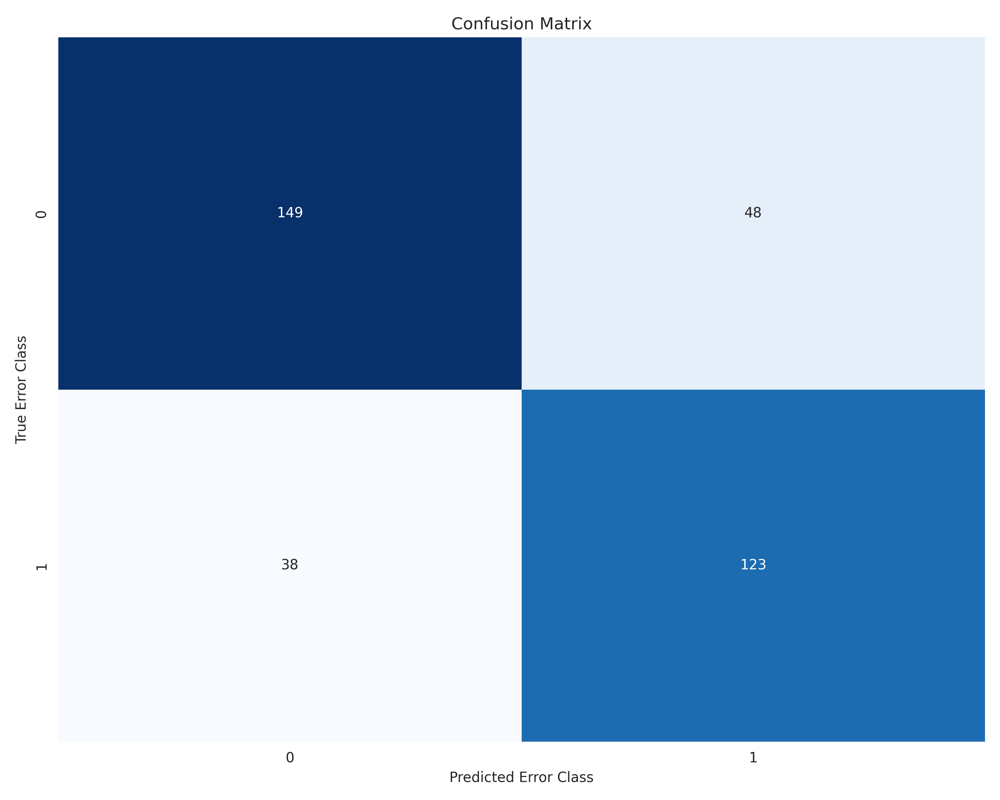
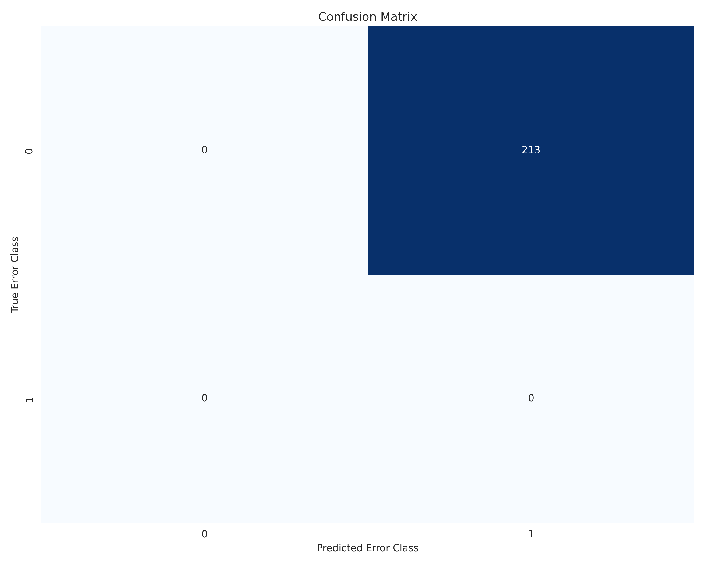

# GNSS Anomaly Detection Convolutional Autoencoder

This document explains and defines the implementation, architecture, and deployment specifications for the Convolutional Neural Network (CNN) based Autoencoder solution designed for the real-time detection of Global Navigation Satellite System (GNSS) anomalies, specifically jamming and spoofing. 

## 1. Model Objective and Anomaly Detection Paradigm

The primary objective of this model is to identify malicious GNSS interference via a data reconstruction paradigm. Operating as an autoencoder, it functions as a highly specialized data compressor and decompressor for temporal GNSS observations.

During the first phase, the "encoder" ingests high-dimensional signal measurements and forces them through a narrow bottleneck. This compresses the data into a low-dimensional latent space, summarizing the signals into their essential core patterns. The "decoder" is then tasked with rebuilding the original, complex input using strictly this condensed summary.

Because the network is trained exclusively on clean GNSS data, it is highly attuned to nominal signal topologies and successfully minimizes the reconstruction Mean Squared Error (MSE):

$$MSE = \frac{1}{N}\sum_{n=0}^{N-1}\left(X_n-\hat{X}_n\right)^2$$

When the system receives clean satellite signals, it can rebuild the data almost perfectly. However, when subjected to out-of-distribution (OOD) data —specifically unnatural distortions from spoofing or jamming events— the latent representation is perturbed. The decoder consequently fails to rebuild the data accurately, causing a statistically significant spike in the reconstruction error. By mapping this scalar error to a cumulative density function, the system instantly detects and flags anomalies in the GNSS environment.

## 2. Data Preprocessing and Tensor Structure

The model processes raw RTCM messages (Types 107x and 109x). A preprocessing pipeline parses this data using the Python `PyRTCM` library to extract necessary satellite ephemeris and observation data, structuring it for the neural network.

1.  **Parsing:** Raw RTCM transmission data is parsed using the `PyRTCM` library. From the parsed RTCM transmitted data, only GPS and Galileo constellations & their respective L1 and L2 or E1, E5a and E5b bands are considered. This returns a set of 148 unique satellite-band combinations (Num_Sat (Const_SatID_Band)): GPS data satellites whose number is in the range [1, 32] across the L1 and L2 bands plus Galileo satellites [2, 3, 4, 5, 6, 7, 8, 9, 10, 11, 12, 13, 15, 16, 18, 19, 21, 23, 25, 26, 27, 29, 30, 31, 32, 33, 34, 36] across the E1, E5a, and E5b bands. Missing and unobserved satellites or bands in any given epoch are zero-padded to maintain matrix rigidity.

    *Notice that these constellations have been chosen, but the model can be generalized to consider other constellations such as Beidou or Glonass*

2.  **Physical Metric Conversion:** Raw data is mathematically converted into physical metrics. We calculate the absolute signal pseudorange (in meters) and the signal phase (carrier phase in cycles) utilizing the speed of light and exact signal frequencies. We consider the following 4 features:
    *   **CN0 (Carrier-to-Noise Density):** Represents the ratio of the carrier signal power to the noise power density. It acts as a primary indicator of signal quality. For instance, spoofing or jamming often introduces unnatural fluctuations here. 

    *   **Pseudorange ($\rho$):** The calculated apparent distance between the satellite and the receiver, derived from the time-of-flight of the GNSS signal code.
    *   **Carrier Phase ($\Phi$):** The measure of the phase of the received carrier wave. It provides a highly precise but mathematically ambiguous range measurement.
    *   **CMC (Code-Minus-Carrier) Computation:** Isolates specific error sources by subtracting the carrier phase measurement (scaled to meters by its signal wavelength, $\lambda$) from the pseudorange:
        $$CMC = \rho - \Phi \cdot \lambda$$
        This removes common spatial components (geometric range, clock errors, tropospheric delays). The residual primarily contains ionospheric delay variations, multipath effects, and receiver noise. Anomalous CMC variances are strong indicators of signal manipulation.

    *Table 1: Example of three lines of parsed and converted input data prior to matrix pivoting.*

    | Epoch (Timestamp) | Const. | SatID | Band | CN0 (dB-Hz) | Pseudorange (m) | Carrier Phase (cycles) | CMC (m) |
    | :--- | :--- | :--- | :--- | :--- | :--- | :--- | :--- |
    | 1772389514 | GPS | 17 | L1 | 32 | 24175344.97 | 127042310.2 | -2.84 |
    | 1772389514 | GAL | 36 | E1 | 46 | 24475305.70 | 128618618.92 | -1.01 |
    | 1772389515 | GPS | 14 | L1 | 32 | 24174759.42 | 127039233.30 | -2.87 |

3.  **Temporal Windowing:** The continuous sequential data is sliced into sliding windows of $W = 120$ epochs, corresponding to approximately 2 minutes of continuous observation at a 1 Hz refresh rate.

    *Table 2: Slice of the Pseudorange (m) feature matrix post-windowing (showing 2 satellite-bands across different temporal epochs).*
    | Num_Sat | $t_{n}$ | $t_{n+1}$ |... | ... | $t_{n+118}$ | $t_{n+119}$ |
    | :--- | :--- | :--- | :--- | :--- | :--- | :--- | 
    | GPS_17_L1 | 24175344.97 | 24174759.42 | ... | ... | 24105895.42 | 24105313.57 |
    | GAL_36_E1 | 24475305.70 | 24475522.00 | ... | ... | 24501205.42 | 24501424.28 |

4.  **Matrix Pivoting & Filtering:** The tabular data is pivoted and reshaped into a dense 3D NumPy array of shape: `(Epochs, Features, Num_Sat)`. Satellites or bands not matching the expected L1/L2 (GPS) and E1/E5b (Galileo) configurations (totaling 148 available combinations) are zero-padded to maintain matrix rigidity.

5.  **Normalization:** Prior to inference, the input matrices are strictly normalized to zero mean ($\mu = 0$) and unit variance ($\sigma^2 = 1$) utilizing the standard scaler statistics derived from the clean training dataset.
6.  **Tensor Creation:** Finally, the parsed sequential data is mapped into a 4D input tensor defined by `(Num_batch, Feature_id, Num_Sat, Window_length)`:
    *   **Num_batch:** Arbitrary batch dimension used to train the network model.
    *   **Feature_id (4 Channels):** The features previously stated.
    *   **Num_Sat (148):** Captures the available satellite PRNs and operational bands.
    *   **Window_length (120):** A continuous temporal window of 120 epochs.

## 3. Architecture Details

The anomaly detector is implemented in PyTorch and compiled using the OpenVINO 2022.3 toolkit for execution on the Myriad X VPU architecture (validated via Ubotica's Rupia application). The architecture strictly preserves the spatial dimensions (satellite PRNs and bands) while applying convolutional compression along the temporal dimension.

A visual representation of the model architecture is available here: 

### 3.1. Encoder Pipeline
The encoder sequentially extracts spatiotemporal features while downsampling the temporal window:
-   **Input Shape:** Ingests a 4D tensor of shape `(Num_batch, Feature_id, Num_Sat, Window_length)`. The validated ONNX graph expects an input shape of `(1, 4, 148, 120)`.
-   **Conv Block 1:** 2D Convolution (Kernel: $1 \times 15$, Padding: 'same') $\rightarrow$ ReLU $\rightarrow$ MaxPool2d (Kernel: $1 \times 2$, Stride: $1 \times 2$). The temporal window is halved to 60, outputting a `1x3x148x60` tensor.
-   **Conv Block 2:** 2D Convolution (Kernel: $1 \times 15$, Padding: 'same') $\rightarrow$ ReLU $\rightarrow$ MaxPool2d (Kernel: $1 \times 2$, Stride: $1 \times 2$). The temporal window is halved again to 30, outputting a `1x2x148x30` tensor.

### 3.2. Latent Space Bottleneck
-   **Flattening:** The tensor is reshaped into a dense 1D vector of 8,880 elements ($2 \times 148 \times 30$).
-   **Dense Compression:** To prevent VRAM exhaustion, a hidden dense layer scales this down to 256 before projecting into a strictly constrained final latent dimension of 128.

### 3.3. Decoder Pipeline
-   **Dense Expansion:** Dense layers project the 128-dimensional latent vector back through the 256-node hidden layer to the 8,880-dimensional flattened state.
-   **Reshape:** Tensor is reshaped to `(1, 2, 148, 30)` to prepare for spatial decoding.
-   **Deconv Block 1:** ConvTranspose2d (Kernel: $1 \times 15$, Stride: $1 \times 2$) $\rightarrow$ ReLU. Upsamples the window to 60 (`1x3x148x60`).
-   **Deconv Block 2:** ConvTranspose2d (Kernel: $1 \times 15$, Stride: $1 \times 2$). Upsamples the window back to the original 120 (`1x4x148x120`).
-   **Interpolation Fallback:** If dimensional mismatch occurs during forward propagation, bilinear interpolation (`F.interpolate`) enforces exact original input dimensions.

## 4. Mathematical Framework for Anomaly Detection

### 4.1. Reconstruction Error
Anomaly scoring begins by evaluating the deviation between the pristine input tensor $X$ and the model's reconstructed tensor $\hat{X}$. This is quantified via the Sum of Squared Errors (SSE) aggregated across all channels ($c$), spatial satellite combinations ($s$), and temporal window epochs ($w$):

$$SSE = \sum_{c, s, w} (X_{c,s,w} - \hat{X}_{c,s,w})^2$$

### 4.2. Statistical Modeling
Raw errors (e.g., an SSE of 15.4) are mathematically meaningless in isolation. They are mapped against a pre-calculated statistical baseline derived strictly from clean training data. Thus, this SSE value is processed through a Lognormal Cumulative Distribution Function (CDF). In this implementation, the Lognormal distribution is defined according to its shape ($s$), loc, and scale parameters. This maps the error into a strictly bounded cumulative probability between $0.0$ and $1.0$ (e.g., a value of $0.98$ implies the error is larger than 98% of baseline clean data reconstruction errors). 

The mathematical expression for this parameterized Lognormal CDF is:

$$F(x, \text{loc}, \text{scale}, s) = \frac{1}{2} + \frac{1}{2} \text{erf}\left(\frac{\ln(x - \text{loc}) - \ln(\text{scale})}{s \sqrt{2}}\right)$$

Where:
*   $s$ represents the shape parameter (equivalent to the standard deviation of the log of the distribution). 
*   $\text{loc}$ is the location shift of the distribution. 
*   $\text{scale}$ corresponds to the median of the distribution (equivalent to $\exp(\mu)$). 

### 4.3. Decision Rule

The Lognormal mapping projects the error into a bounded anomaly score $P \in [0, 1]$. A dynamic cut-off threshold $\tau$ is then applied to classify the window. While a standard conservative threshold (e.g., $\tau \ge 0.99$) can be enforced to minimize false positives, the optimal deployment strategy involves sweeping the probability space against a localized validation set to find the threshold $\tau$ that maximizes the global F1-score:

$$F1\text{-}Score = 2 \times \frac{Precision \times Recall}{Precision + Recall}$$

where,
$$Precision = \frac{True\ Positives}{True\ Positives + False\ Positives}$$
$$Recall = \frac{True\ Positives}{True\ Positives + False\ Negatives}$$

An example of the threshold vs. F1-Score tradeoff is shown here:

## 5. Datasets and Training Process

The network weights are optimized via the Adam optimizer, utilizing L2 regularization and Early Stopping to mitigate overfitting. Two core datasets are used across the training and evaluation phases:

*   **Dataset A (Training and Testing):** A publicly available dataset (Wang, X., Yang, J., Huang, M., & Peng, Z. 2024. GNSS interference and spoofing dataset. *Data in Brief*, 54, 110302). Recorded via a low-cost sensor at the Yunnan University Science Hall (25º03'26'' N, 102º41'55'' E), it contains UBLOX measurements mapped to RTCM formats. 
    *   *Dataset A.1 (Clean):* Used exclusively to train the autoencoder's weights and baseline CDF. 
    

    *   *Dataset A.2 (Anomalies):* Contains active jamming and spoofing events. Used for validation.
    

*   **Dataset B (Domain Transfer):** A dataset of strictly clean measurements gathered from the Spanish IGN (Instituto Geográfico Nacional) network in its base placed at Barcelona's maritime port (41º20'30'' N, 2º09'56'' E). Used to test zero-shot transfer and perform online CDF recalibration.
    

## 6. Model Performance and Generalization

The model's ability to accurately reconstruct data and classify anomalies has been rigorously evaluated:

*   **In-Distribution Nominal:** Evaluated on the clean test split of Dataset A.1, the model achieves an accuracy of 83.6%.
    

*   **In-Distribution Anomalies:** When fed with jamming/spoofing anomalies from Dataset A.2, the model successfully detects disruptions with an accuracy of 75.98%.
    

*   **Domain Shift Degradation (Naive Transfer):** When directly transferred to Dataset B without adaptation, the system experiences a significant domain shift drop. Varying satellite geometries, atmospheric delays, and localized IGN receiver noise profiles inflate the reconstruction error, highlighting the necessity of site-specific calibration.
    

## 7. Recalibration Protocol

To resolve cross-scenario domain shifts without requiring massive computational retraining at the edge, a two-stage online recalibration protocol is enforced:

### 7.1. Post-processing Calibration (Zero-Retraining)
Upon deployment in a new physical environment, the system should be permitted to collect an initial baseline of local, nominal observations. The raw SSE statistics for this new environment are aggregated, and the loc, scale and $s$ parameters of the Lognormal CDF are mathematically re-fitted.

* **Performance Recovery:** This simple statistical recalibration technique successfully adapts the probability thresholds to the new environment, recovering accuracy to ~80% entirely without modifying the underlying neural network weights.
    

    
### 7.2. Fallback Neural Adaptation
In extreme domain shifts where CDF recalibration proves insufficient (e.g., swapping from a low-cost patch antenna to a survey-grade choke ring antenna), a fallback fine-tuning strategy is initiated. The deep internal representation layers (the hidden encoder convolutions, the latent dense bottleneck, and the inner transposed convolutions) are mathematically frozen by disabling gradient tracking. Using the localized nominal measurements, only the input convolution layer and the final output transposed convolution layer are fine-tuned. This rapidly adjusts the network's input/output spatial scaling while preserving the core feature-extraction manifold learned during the initial training phase.

## 8. Known Limitations and Out-of-Distribution Behavior

The model's manifold is explicitly constrained to nominal GNSS topologies and is trained to flag deviations specifically matching Jamming and Spoofing signatures. The model is *not* currently designed to accurately classify other topological anomalies (e.g., severe multipath errors, solar flares, ionospheric scintillation). The presence of unmodeled signal topologies may induce domain shifts, resulting in unpredictable false positive or false negative rates.

## 9. Acknowledgement
This work was supported by the AGRARIAN project under Horizon Europe call HORIZON-CL6-2023-GOVERNANCE-01-13, Grant 101134128. Views and opinions expressed are those of the authors only and do not necessarily reflect those of the European Union or European Commission.
