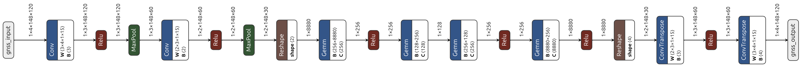

# AgriPrecise Testbed: GNSS Anomaly Detection Module

## 1. Title & Executive Overview

This document provides the technical specifications and operational protocols for the anomaly detection module within the AgriPrecise testbed docker. The module utilizes a Convolutional Autoencoder (CNN-AE) and statistical recalibration to provide real-time, unsupervised detection of malicious GNSS interference (e.g., Jamming and Spoofing) directly from raw RTCM (MSM5 or MSM7) messages. By analyzing signal reconstruction failures, the system reliably flags anomalies while adapting to dynamic, localized environmental noise.

## 2. Docker Folder Structure & Configuration Files

The AgriPrecise testbed docker utilizes a strict directory structure to manage the data processing helpers, inference configurations, and the optimized model executables. The core hierarchy is organized as follows:


```text
└── data/
    ├── dataHelpers/
    │   ├── best_gnss_conv_autoencoder_krn1x15_20260921T155239.onnx.data
    │   ├── conv_autoencoder.onnx
    │   ├── conv_autoencoder_stats_calibrated.json
    │   └── data_scaler.json
    ├── unnHelpers/
    │   └── csa_config.json
    └── unnModels/
        └── conv_autoencoder.unn
```

### File Details:

*   **`dataHelpers/best_gnss_conv_autoencoder_krn1x15_20260921T155239.onnx.data`**: The binary weights file utilized by the ONNX format model during fallback or direct ONNX inference execution.
*   **`dataHelpers/conv_autoencoder.onnx`**: The structural autoencoder model exported in ONNX (Open Neural Network Exchange) format.
*   **`dataHelpers/conv_autoencoder_stats_calibrated.json`**: A configuration file containing the `loc`, `shape`, and `scale` statistical parameters of the fitted Lognormal CDF used to map inference errors to probabilities. 
*(Example: `{"shape": 0.959, "loc": 8392.46, "scale": 112744.14}`)*
*   **`dataHelpers/data_scaler.json`**: Stores the feature-wise means (`means`) and standard deviations (`stds`) derived from clean baseline data. Strictly required for the normalization phase of the input tensor.
    *Example:*
    
    ```json
    {
        "means": [[[[47.36640548706055]], [[24316482.0]], [[109935384.0]], [[-11.174361228942871]]]], 
        "stds": [[[[3.9574837684631348]], [[2228022.5]], [[16692902.0]], [[19.829233169555664]]]]
    }
    ```
*   **`outputData/`**: Directory designated to store and log the inference engine output generated by the Ubotica processing pipeline.
*   **`unnHelpers/csa_config.json`**: A JSON configuration file dictating the initialization and execution parameters for the underlying inference engine.
*   **`unnModels/conv_autoencoder.unn`**: The compiled, quantized, and optimized inference model executable specifically targeted for hardware acceleration on the Myriad X platform.


## 3. End-to-End Pipeline & Architecture

The `GNSS_ConvAutoencoder` processes high-dimensional GNSS temporal data by compressing it through a spatial-temporal convolutional encoder into a dynamic bottleneck, and then rebuilding it via a transposed convolutional decoder. To ensure low-latency edge execution, the model is fully compiled and optimized using Intel OpenVINO 2022.3 for hardware-accelerated inference on the Intel Movidius Myriad X VPU.




## 4. Input / Output Data Specifications, Signal Preprocessing & Inference Process

The module is designed to operate on continuous data streams, specifically RTCM raw stream messages. The preprocessing and inference stages are highly optimized for efficiency and tensor rigidity.

* **Raw Input (Preprocessing):** The system continuously listens to RTCM raw stream messages. For each stream, temporal data is accumulated and processed in discrete chunks of 120 epochs.

* **Filtering and Parsing Data (Preprocessing):** Parsing is executed utilizing the Python `pyrtcm` library. The system explicitly filters for RTCM 107x (GPS) and 109x (Galileo) datatype messages. Constellations and bands are mapped across 148 unique satellite-band combinations: GPS (L1, L2) and Galileo (E1, E5b).

* **Physical Conversion (Preprocessing):** The raw fine pseudorange and fine phase data parsed from the RTCM streams are mathematically reconstructed into absolute physical metrics: absolute pseudorange (measured in meters) and carrier phase (measured in cycles).

*   **Considered Features (Preprocessing):** The data is structured into $C=4$ distinct feature channels:
    1.  **CN0:** Carrier-to-Noise Density.
    2.  **Pseudorange:** Absolute apparent distance.
    3.  **Carrier Phase:** Measured in continuous cycles.
    4.  **CMC (Carrier-to-Code-Difference):** Evaluates the divergence between the pseudorange and the carrier phase measurements.

* **Input Tensor Shape & Normalization (Preprocessing):** Prior to inference, the arrays are strictly normalized to zero-mean and unit-variance. The baseline parameters used to normalize this input data are dynamically loaded from the `data/dataHelpers/data_scaler.json` file. The resulting standardized input data format is a 4D tensor of shape: `(1, 4, 148, 120)`.

* **Data Transformation (Preprocessing):** To comply with the constraints of the OpenVINO VPU runtime, the normalized input tensor is explicitly transformed and serialized into `float16` binary raw data.

* **CNN-based Autoencoder Inference Process (Inference):** The compiled VPU model receives the `float16` binary stream. The inference process runs a single forward pass and returns the reconstructed version of the binary raw input data, mirroring the original shape.

### 4.1. Inference Engine Execution Modes

The Docker container supports two distinct inference backends: `csa_inference` (utilizing Ubotica's CSA inference engine on the Myriad X) and `onnx_inference` (utilizing the ONNX runtime via CPU). 

The operational mode is dynamically controlled by passing the `INFERENCE_MODE_ENGINE` environment variable into the Docker container. The routing logic is as follows:

*   `INFERENCE_MODE_ENGINE = 'hybrid_engine'` **(Default)**: The system primarily attempts to use the Ubotica CSA hardware-accelerated inference engine. If the CSA engine times out or encounters a hardware unavailability state, the system automatically falls back to the `onnx_inference` method.
*   `INFERENCE_MODE_ENGINE = 'onnx_engine'`: The hardware CSA inference engine is entirely bypassed. Inference is performed uniquely and strictly using the `conv_autoencoder.onnx` model format.
*   `INFERENCE_MODE_ENGINE = 'csa_engine'`: The system strictly enforces the use of the hardware CSA inference engine, bypassing the ONNX fallback model entirely.

## 5. Postprocessing - Mathematical Framework for Anomaly Detection

The inference pipeline outputs a reconstructed tensor. Postprocessing calculates the reconstruction error and maps it to a bounded anomaly score ($P \in [0, 1]$):

**1. Reconstruction Error (SSE):** 

$$SSE = \sum_{c, s, w} (X_{c,s,w} - \hat{X}_{c,s,w})^2$$

**2. Anomaly Scoring (Lognormal CDF):** 
The SSE is mapped to a probability using a Lognormal CDF parameterized by the baseline clean data:

$$F(x, \text{loc}, \text{scale}, s) = \frac{1}{2} + \frac{1}{2} \text{erf}\left(\frac{\ln(x - \text{loc}) - \ln(\text{scale})}{s \sqrt{2}}\right)$$

**3. Classification:** 
The script evaluates the probability against a dynamic cut-off threshold (e.g., $\tau \ge 0.93$). The final outputs provided to the Docker orchestrator are:
*   The bounded anomaly score ($P$).
*   The final anomaly binary classification (`1` for Anomaly/Attack, `0` for Clean).

## 6. Offline Domain Adaptation and Recalibration Protocols

Because environmental factors (such as the specific antenna placement on an agricultural vehicle) heavily influence the baseline signal noise, the detection logic is highly sensitive to the local domain. When deploying the anomaly detection module in a new, different environment, performance can naturally degrade. To solve this, we propose two distinct offline calibration options to restore accuracy:

### 6.1. Offline CDF Calibration (Zero-Retraining)

The primary and most computationally efficient step is to adapt the statistical thresholds without modifying the neural network weights.

* **Procedure:** First, clean baseline measurements from the new environment must be collected. These measurements are passed through the standard inference engine process, and their raw reconstruction errors (SSE) are captured. These novel errors are then utilized to statistically fit and calibrate the new $(\text{loc}, \text{scale}, s)$ parameters for the Lognormal CDF. Finally, the `conv_autoencoder_stats_calibrated.json` file is updated with these new values.

### 6.2. Partial Neural Network Retraining

If standard CDF recalibration is insufficient to resolve the domain shift performance drop, the network itself requires adaptation.

* **Procedure:** The internal representation layers of the network (the hidden encoder convolutions, latent bottleneck, and inner decoder fully-connected expansions) are mathematically frozen (gradients disabled). Only the input convolutional layer and the final output transposed convolutional layer are retrained utilizing the clean measurements captured from the new environment. Once the new PyTorch model is obtained, it must be re-compiled and optimized via OpenVINO to generate the updated `.unn` file for execution on the Myriad X platform.

## 7. Known Limitations
The model's manifold is explicitly constrained to nominal GNSS topologies and is trained to flag deviations specifically matching Jamming and Spoofing signatures. The model is not currently designed to accurately classify other topological anomalies (e.g., severe multipath errors, solar flares, ionospheric scintillation). The presence of unmodeled signal topologies may induce domain shifts, resulting in unpredictable false positive or false negative rates.

## 8. Acknowledgement
This work was supported by the AGRARIAN project under Horizon Europe call HORIZON-CL6-2023-GOVERNANCE-01-13, Grant 101134128. Views and opinions expressed are those of the authors only and do not necessarily reflect those of the European Union or European Commission.
